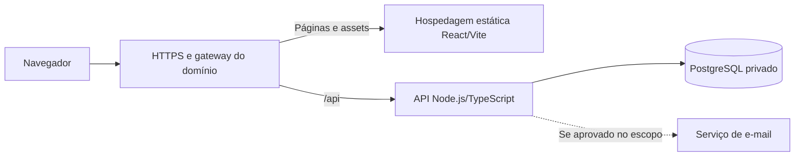

# Arquitetura inicial

**Data:** 2026-11-06  
**Status:** proposta para orientar a implementação; aplicação e infraestrutura ainda não implementadas.  
**Entrada de requisitos:** [definição do projeto](DEFINICAO-DO-PROJETO.md).

## 1. Decisões e limites

| Item | Situação |
|---|---|
| Frontend com React + Vite | Confirmado pelo responsável pelo projeto |
| Backend com Node.js + TypeScript | Confirmado pelo responsável pelo projeto |
| Banco PostgreSQL | Confirmado pelo responsável pelo projeto |
| Autenticação como primeira funcionalidade | Confirmado; fluxos e regras pendentes |
| Documentação contínua e preparação para deploy | Confirmado como requisito de engenharia |
| TypeScript também no frontend | Proposta para facilitar contratos e manutenção |
| Organização, protocolos e mecanismos abaixo | Propostas; ajustar após preencher o briefing |

Framework do backend, ORM, biblioteca visual, serviço de identidade e provedores de hospedagem permanecem em aberto. Não há requisito confirmado de múltiplas organizações, cobrança, tempo real ou aplicativo móvel.

## 2. Organização proposta

Um monorepo mantém frontend, API, contratos e documentação juntos. A API começa como um monólito modular organizado por funcionalidade; o primeiro módulo é `auth`. Novos módulos serão definidos pelo domínio confirmado.

```text
apps/
  web/                 # React + Vite; telas, componentes e integração HTTP
  api/                 # Node.js + TypeScript; módulos e ponto de entrada
packages/
  contracts/           # Formatos públicos de entrada, saída e erros
docs/                  # Requisitos, arquitetura, operação e contratos
infra/                 # Configuração local e artefatos futuros de deploy
```

Essa árvore é um plano, não um conjunto de pastas já implementadas. Gerenciador de pacotes e ferramenta de workspace serão escolhidos na implementação. Não introduzir microserviços, filas ou cache externo sem uma necessidade demonstrada.

Dentro de cada módulo da API, separar responsabilidades sem multiplicar camadas:

- **HTTP:** rotas, validação de entrada, autenticação e tradução de erros.
- **Aplicação:** casos de uso, autorização e coordenação de operações.
- **Domínio:** regras de negócio que precisam existir independentemente do transporte.
- **Infraestrutura:** persistência, serviço de e-mail e outros provedores externos.

Regras de negócio não dependem de componentes React ou objetos do framework HTTP. Acesso ao banco acontece somente no backend. Consultas e migrações não são expostas diretamente ao navegador.

## 3. Fluxo de execução proposto



A proposta usa o mesmo domínio público para web e `/api`, com roteamento explícito no gateway. Rotas da API precedem o fallback da SPA; uma falha da API não deve receber `index.html`. Rotas internas do React precisam funcionar quando abertas diretamente.

Se web e API ficarem em domínios ou origens diferentes, revisar cookies, envio de credenciais, origens permitidas, CORS e proteção CSRF antes do deploy. A topologia final depende do provedor escolhido.

## 4. Contratos e fronteiras

- Propor uma API REST com contratos documentados; o formato de versionamento será definido com os primeiros endpoints.
- Compartilhar somente contratos públicos em `packages/contracts`; entidades do banco, segredos e código de persistência ficam no servidor.
- Validar entradas e respostas nas fronteiras em execução; tipos TypeScript não substituem validação de dados recebidos.
- Padronizar erros com código estável, mensagem apropriada ao usuário e identificador da requisição. Detalhes internos não saem na resposta pública.
- Definir paginação e limites antes de expor listagens potencialmente grandes.
- Manter regras de autorização na API, mesmo quando a interface também restringir telas e ações.

## 5. Autenticação: base proposta

A escolha entre identidade externa e credenciais locais depende das respostas do briefing. Para uma aplicação web própria, avaliar sessões mantidas no servidor, com identificador opaco em cookie `HttpOnly`, `Secure` em HTTPS e política `SameSite` adequada. Expiração, renovação, revogação e acesso simultâneo precisam de regras explícitas. [Referência: sessões OWASP](https://cheatsheetseries.owasp.org/cheatsheets/Session_Management_Cheat_Sheet.html).

- Se forem usadas sessões, persistir o estado de modo compatível com reinícios e réplicas; não depender apenas da memória de um processo.
- Proteger mutações contra CSRF, com validação de origem e mecanismo apropriado à topologia; `SameSite` é uma camada adicional de defesa.
- Limitar tentativas de autenticação e recuperação. Com múltiplas réplicas, o controle precisa de estado compartilhado ou proteção equivalente no gateway.
- Se houver senha local, usar hashing de senhas apropriado, parâmetros revisados e biblioteca mantida; nunca armazenar senha em texto ou criptografia reversível.
- Prever encerramento e invalidação de sessão; recuperação de senha e confirmação de e-mail só entram conforme o escopo aprovado.
- Evitar respostas que facilitem descobrir contas existentes e não registrar credenciais ou identificadores de sessão nos logs.
- Aplicar autorização e isolamento dos dados no servidor conforme o modelo escolhido: individual, equipe ou organização.

Esses itens são critérios de projeto, ainda não controles implementados. MFA e login social são decisões pendentes. [Referência: autenticação OWASP](https://cheatsheetseries.owasp.org/cheatsheets/Authentication_Cheat_Sheet.html).

## 6. Valores financeiros, datas e apresentação

- Propor `NUMERIC` para valores que exigem precisão decimal; escala, limites e arredondamento serão definidos por campo após esclarecer o domínio. Não assumir duas casas para preços, quantidades e taxas. [Referência: tipos numéricos PostgreSQL](https://www.postgresql.org/docs/current/datatype-numeric.html).
- Transportar valores decimais exatos como strings nos contratos e fazer aritmética decimal no backend. O frontend formata a apresentação sem alterar o valor canônico; conversões necessárias aos gráficos devem ser explícitas e limitadas à visualização.
- Definir moeda, unidade, precisão e significado de cada indicador. Ausência de informação deve ser diferente de zero; dados demonstrativos e dados desatualizados precisam de identificação visível.
- Usar ISO 8601 nos contratos de instantes e `timestamptz` no PostgreSQL; usar `DATE` quando o conceito for uma data de negócio, sem horário. Preservar um fuso de negócio separado quando ele tiver significado próprio. [Referência: datas PostgreSQL](https://www.postgresql.org/docs/current/datatype-datetime.html).
- Manter fonte, horário da observação e horário da atualização quando esses metadados existirem; regras de cotação e rentabilidade ainda serão especificadas.
- Definir tokens visuais de tipografia, espaçamento, cores e estados; priorizar hierarquia dos valores, alinhamento de números e leitura em diferentes telas.
- Combinar cor com texto ou símbolos para ganhos e perdas, preservar contraste e navegação por teclado. Tema e identidade visual dependem do briefing. [Referência: WCAG 2.2](https://www.w3.org/WAI/WCAG22/quickref/).

## 7. Preparação para deploy

| Ambiente | Preparação proposta |
|---|---|
| Local | Banco PostgreSQL em container; API executável localmente e por container; web em desenvolvimento com Vite |
| Staging | Ambiente separado para validar build, migração, autenticação e integração antes de produção; dados fictícios ou apropriados ao teste |
| Produção | Build estático do frontend, serviço da API e PostgreSQL com acesso restrito; HTTPS e segredos próprios |

O frontend deve ser publicado a partir do build de produção; `vite preview` serve à verificação local, não à hospedagem de produção. A API precisa de imagem reproduzível e execução sem ferramentas de desenvolvimento. Provedor e forma de hospedagem do banco continuam pendentes. [Referência: deploy estático Vite](https://vite.dev/guide/static-deploy.html).

Checklist a materializar na implementação:

- [ ] Definir runtime suportado, gerenciador de pacotes e lockfile; fixar versões nas imagens e no pipeline.
- [ ] Separar configuração por ambiente; manter `.env.example` apenas com nomes e valores fictícios.
- [ ] Manter URL e credenciais do banco, chaves e segredos somente no servidor ou no cofre de segredos escolhido.
- [ ] Tratar `VITE_*` como configuração pública incorporada ao bundle; mudanças dessas variáveis exigem novo build no modelo padrão. [Referência: variáveis Vite](https://vite.dev/guide/env-and-mode).
- [ ] Configurar HTTPS, encaminhamento correto de headers no proxy e política de acesso ao banco.
- [ ] Automatizar migrações versionadas, com execução serializada por ambiente antes de direcionar tráfego que dependa do novo schema.
- [ ] Validar na staging o fluxo real de autenticação, cookies, rotas da SPA e conexão da API ao banco.
- [ ] Publicar procedimentos de deploy, diagnóstico, rollback e restauração antes da primeira produção.

## 8. Pipeline e operação

O pipeline proposto verifica instalação reproduzível, lint, tipos, testes pertinentes, build do frontend/API e coerência entre contratos e documentação. Testes de integração devem usar PostgreSQL isolado; testes de autenticação cobrem acesso negado, autorização e encerramento de sessão. Nenhum desses checks existe ainda.

Antes de liberar tráfego:

- **Liveness:** indicar que o processo está vivo sem expor informações sensíveis.
- **Readiness:** confirmar capacidade de atender, incluindo banco e dependências essenciais ao serviço; uma integração opcional indisponível não deve derrubar toda a API.
- **Encerramento:** retirar readiness, parar novas requisições, aguardar as em andamento por tempo limitado e fechar o pool do banco no desligamento.
- **Logs:** usar formato estruturado e identificador de requisição; remover senhas, tokens, cookies e posições financeiras detalhadas.
- **Monitoramento:** acompanhar erros, latência, disponibilidade e saturação do banco; definir responsáveis e canais antes da produção.
- **Backup:** definir retenção, acesso, RPO e RTO com o responsável; executar e registrar um teste de restauração. A existência de backup não comprova recuperação.
- **Rollback:** conservar artefatos da versão anterior e validar compatibilidade de schema. Preferir migrações graduais de expansão/contração; voltar a aplicação não desfaz automaticamente uma alteração destrutiva no banco.

## 9. Documentação durante a implementação

O briefing registra requisitos e respostas; este arquivo registra a arquitetura proposta e suas revisões. O README deve apontar para instalação, execução e documentação vigente.

Cada entrega deve atualizar as partes afetadas: contratos da API, variáveis de ambiente, migrações, decisões técnicas, testes e instruções operacionais. Registrar o motivo das escolhas relevantes e distinguir proposta, decisão aceita e comportamento implementado. Não preencher lacunas de negócio com hipóteses silenciosas.

Uma entrega só pode ser descrita como pronta para deploy depois de executar os checks definidos e verificar o ambiente de destino; documentação ou build local, isoladamente, não comprovam operação em produção.

## 10. Decisões pendentes e próxima implementação

Preencher primeiro as perguntas essenciais de [DEFINICAO-DO-PROJETO.md](DEFINICAO-DO-PROJETO.md): público, propriedade dos dados, limites da primeira entrega, entrada e recuperação de conta, permissões e destino do deploy.

Com essas respostas, detalhar o modelo de autenticação e os contratos; então selecionar framework da API, persistência, bibliotecas visuais e infraestrutura. Fontes de dados, cálculos e integrações precisam de requisitos próprios antes de implementar os módulos de investimentos.

A sequência técnica proposta é: confirmar o briefing, preparar workspace e configuração local, implementar autenticação com testes, validar a direção visual e publicar uma versão verificada em staging. O escopo do dashboard depende da resposta sobre a primeira entrega.
